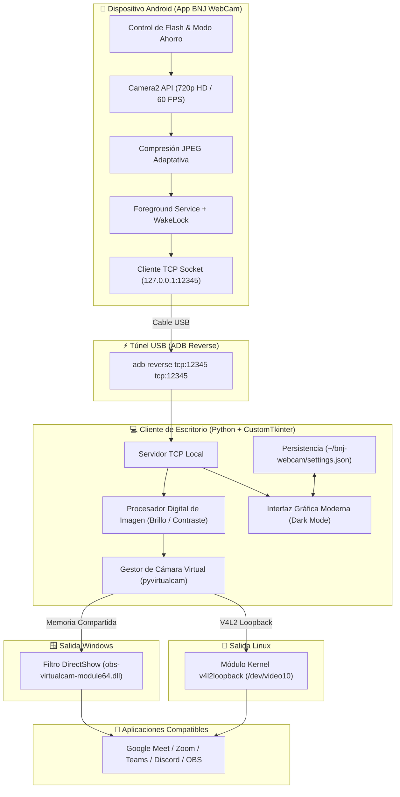

# 📷 BNJ WebCam

<div align="center">

**Convierte tu dispositivo Android en una cámara web profesional de ultra baja latencia para Windows y Linux.**

[](LICENSE)
[](#requisitos-del-sistema)
[](#arquitectura-del-sistema)
[](#características-destacadas)

</div>

---

## 📖 Descripción General

**BNJ WebCam** es una solución integral y de código abierto diseñada para transformar teléfonos y tabletas Android en cámaras web virtuales de alto rendimiento para **Windows (10 y 11)** y distribuciones **Linux (Debian, Ubuntu, Mint, Pop!_OS)**.

A diferencia de las soluciones comerciales convencionales que sufren de compresión excesiva, caídas de señal inalámbrica y anuncios molestos, **BNJ WebCam** transmite directamente a través del cable USB usando el túnel local de Android Debug Bridge (`adb reverse`). Esto garantiza:
* **Cero dependencia de redes Wi-Fi**: No importa si la red local está saturada o si no hay conexión a internet.
* **Ultra baja latencia**: Flujo de fotogramas procesado en tiempo real con memoria compartida (IPC).
* **Integración nativa**: En Windows utiliza el filtro DirectShow de OBS Virtual Camera **sin requerir tener OBS Studio abierto**, haciéndola reconocida automáticamente por Zoom, Google Meet, Microsoft Teams, Discord, Skype, OBS Studio y navegadores web. En Linux se conecta al módulo estándar `v4l2loopback`.

---

## 🚀 Características Destacadas

* 🟢 **Cámara Virtual Siempre Activa**: Funciona al instante como dispositivo de captura DirectShow (Windows) o `/dev/video10` (Linux) en cualquier software de videollamadas o streaming.
* 🎛️ **Controles de Imagen en Vivo desde PC**:
  * **Tasa de Cuadros (FPS)**: Selección directa entre 25, 30, 48 y 60 FPS.
  * **Tasa de Bits Adaptativa (Bitrate)**: Ajuste en tiempo real de 800 kbps a 5000 kbps.
  * **Compensación de Exposición (EV)**: Control a nivel de hardware de la cámara del móvil (-4 a +4 EV).
  * **Brillo y Contraste Digital**: Filtros acelerados por vectorización aplicados en menos de 0.3 ms por fotograma.
* 🔋 **Modo Ahorro de Energía (Pantalla Oscura)**: Permite oscurecer por completo la pantalla del teléfono mientras transmite en primer plano, evitando el calentamiento de la batería en videollamadas prolongadas.
* 🔦 **Control de Linterna**: Activa y desactiva el flash trasero de la cámara desde la aplicación Android.
* 🤝 **Protocolo de Handshake Estable**: Evita falsos positivos y parpadeos entre los estados `Transmitiendo a PC` y `Esperando PC`.
* 💾 **Configuración Recordada Automática**: Todos los ajustes seleccionados se guardan de forma persistente en `~/bnj-webcam/settings.json` tanto en Windows como en Linux.
* 🔌 **Detección Plug-and-Play**: Reconocimiento automático de dispositivos Android conectados y autorizados por USB.

---

## 🏗️ Arquitectura del Sistema



---

## 📁 Estructura del Repositorio

El proyecto mantiene una estructura modular y organizada por plataforma:

```text
bnj_webcam/
├── android/                         # Aplicación móvil para Android (Kotlin + Gradle)
│   ├── app/
│   │   ├── src/main/java/           # CameraStreamService y MainActivity
│   │   └── src/main/res/            # Recursos gráficos y diseño
│   ├── build.gradle                 # Configuración de compilación Android
│   └── gradlew / gradlew.bat        # Gradle Wrapper
│
├── client/                          # Cliente de escritorio multiplataforma (Python)
│   ├── adb/windows/                 # Binarios integrados de Android Debug Bridge
│   ├── assets/                      # Iconos, logotipos y recursos visuales
│   ├── drivers/                     # Controladores DirectShow de OBS Virtual Cam
│   ├── main.py                      # Interfaz gráfica (CustomTkinter) y lógica
│   ├── vcam_manager.py              # Administrador de cámara virtual e IPC
│   ├── bnj_webcam.iss               # Script del instalador oficial de Windows (Inno Setup)
│   └── requirements.txt             # Dependencias de Python
│
├── packaging/                       # Herramientas de empaquetado para distribución
│   ├── linux/                       # Empaquetador de instalador Debian / Ubuntu (.deb)
│   │   ├── DEBIAN/                  # Control, postinst (v4l2loopback + udev) y prerm
│   │   ├── usr/                     # Lanzador global y archivos de escritorio (.desktop)
│   │   └── build_deb.sh             # Script automatizado de compilación .deb
│   └── windows/                     # Automatización para compilación en Windows
│       ├── build_installer.ps1      # Compila con PyInstaller e Inno Setup
│       └── README.md                # Guía de empaquetado en Windows
│
├── LICENSE                          # Licencia de código abierto
└── README.md                        # Documentación principal del proyecto
```

---

## 📱 1. Aplicación Android

### Requisitos
* Dispositivo con **Android 7.0 (Nougat, API 24)** o superior.
* Depuración por USB habilitada en las *Opciones de desarrollador*.

### Uso
1. Conecta el dispositivo a la computadora con un cable USB.
2. Abre la app **BNJ WebCam** y concede los permisos de cámara y notificaciones.
3. Elige la cámara (trasera, frontal o externa).
4. Pulsa **Iniciar cámara**.
5. *(Opcional)* Activa el **Modo Ahorro** para oscurecer la pantalla mientras continúas transmitiendo.

### Compilación desde el código fuente
Para compilar el archivo APK:
```bash
cd android
./gradlew assembleDebug
# El APK se generará en: android/app/build/outputs/apk/debug/app-debug.apk
```

---

## 🪟 2. Cliente Windows (Windows 10 y 11)

### Opción A: Instalador Oficial (.exe)
1. Descarga y ejecuta el instalador generado en `client/installer_output_webcam/BNJ_WebCam_Setup.exe`.
2. El asistente en español registrará automáticamente los controladores DirectShow de 64 y 32 bits (`obs-virtualcam-module64.dll` y `obs-virtualcam-module32.dll`) sin requerir instalar OBS Studio.
3. Inicia la aplicación desde el acceso directo del escritorio o menú inicio.

### Opción B: Ejecutar desde Código Fuente
```powershell
# 1. Instalar dependencias
pip install -r client\requirements.txt

# 2. Ejecutar cliente
python client\main.py
```

### Opción C: Compilar el Ejecutable e Instalador
Ejecuta el script de empaquetado automatizado:
```powershell
powershell -ExecutionPolicy Bypass -File .\packaging\windows\build_installer.ps1
```

---

## 🐧 3. Cliente Linux (Debian, Ubuntu, Mint)

### Opción A: Paquete Instalador (.deb)
1. Genera o descarga el paquete `.deb`:
   ```bash
   chmod +x packaging/linux/build_deb.sh
   ./packaging/linux/build_deb.sh
   ```
2. Instálalo con `apt` para resolver dependencias del sistema:
   ```bash
   sudo apt update
   sudo apt install ./BNJ_WebCam_1.0.0_all.deb
   ```
   > El paquete configura automáticamente el módulo de kernel `v4l2loopback` en `/etc/modules-load.d/`, asigna `/dev/video10` con el nombre `BNJ WebCam`, e instala reglas `udev` para acceso USB sin permisos de superusuario.

3. Ejecuta la aplicación desde tu menú o con el comando:
   ```bash
   bnj-webcam
   ```

### Opción B: Ejecución Manual en Linux
Asegúrate de tener cargado el módulo de cámara virtual:
```bash
sudo apt install v4l2loopback-dkms adb python3-pip python3-tk
sudo modprobe v4l2loopback devices=1 video_nr=10 card_label="BNJ WebCam" exclusive_caps=1
pip3 install -r client/requirements.txt
python3 client/main.py
```

---

## ⚙️ Configuración y Persistencia

La aplicación guarda automáticamente tus preferencias para que no tengas que reconfigurarlas en cada inicio:
* **Ubicación en Windows**: `C:\Users\<TuUsuario>\bnj-webcam\settings.json`
* **Ubicación en Linux**: `/home/<tu_usuario>/bnj-webcam/settings.json`

### Ejemplo de Archivo de Configuración
```json
{
  "adb_serial": "RFCW10XXXXX",
  "adb_model": "SM-G991B",
  "brightness": 0,
  "contrast": 1.0,
  "exposure": 0,
  "bitrate": 2500,
  "fps": 30
}
```

---

## 📡 Protocolo de Red Local

La comunicación entre el móvil y la PC se realiza mediante un socket TCP en `127.0.0.1:12345`:
* **Encabezado (5 bytes)**:
  * `Byte 0`: Tipo de paquete (`1` = Cuadro JPEG de video, `3` = Parámetros de configuración).
  * `Bytes 1-4`: Longitud del payload en formato big-endian (`uint32`).
* **Carga Útil (Payload)**:
  * Para video: Flujo binario JPEG listo para decodificación y reenvío a la cámara virtual.
  * Para configuración: Parámetros serializados (`fps`, `bitrate`, `exposure`) para aplicar dinámicamente en la cámara de Android.

---

## ❓ Preguntas Frecuentes (FAQ)

<details>
<summary><b>¿Por qué el estado parpadeaba antes y cómo se solucionó?</b></summary>
Anteriormente, la conexión inicial del socket ADB se activaba en cuanto el teléfono abría el puerto local, provocando que la interfaz saltara brevemente a "Transmitiendo" aun si el cliente no estaba listo. Se implementó un protocolo de saludo bidireccional (handshake) con paquete de ajustes: el estado pasa a conectado únicamente cuando la PC confirma la recepción del stream.
</details>

<details>
<summary><b>¿Se necesita tener OBS Studio instalado en la computadora?</b></summary>
No. BNJ WebCam incluye y registra directamente los módulos DLL de DirectShow de OBS Virtual Camera (`obs-virtualcam-module64.dll` y `obs-virtualcam-module32.dll`), los cuales pesan menos de 500 KB en total y son registrados en Windows sin necesidad de OBS.
</details>

<details>
<summary><b>¿Cómo activo la Depuración por USB en Android?</b></summary>
Ve a <i>Ajustes > Acerca del teléfono</i> y pulsa 7 veces consecutivas sobre <i>Número de compilación</i>. Luego, dirígete a <i>Ajustes > Opciones de desarrollador</i> y activa la casilla <b>Depuración por USB</b>. Al conectar el cable, acepta la solicitud de autorización en pantalla.
</details>

---

## 🤝 Contribuciones

Las contribuciones son bienvenidas:
1. Haz un fork de este repositorio.
2. Crea una rama para tu funcionalidad (`git checkout -b feature/nueva-mejora`).
3. Realiza tus cambios y genera un commit (`git commit -m 'feat: agregar soporte para resolución 1080p'`).
4. Sube la rama (`git push origin feature/nueva-mejora`).
5. Abre un **Pull Request**.

---

## 📄 Licencia

Este proyecto está distribuido bajo la [Licencia de Código Abierto BNJ WebCam](LICENSE). Puedes utilizarlo, modificarlo y distribuirlo libremente.

---

## 🌐 Enlaces Oficiales y Contacto

* **Autor**: Benjamín Duarte (BNJ)
* **Sitio Web Oficial**: [benjaminduarte.lat](https://benjaminduarte.lat/)
* **Canal de YouTube**: [Benjamín Duarte en YouTube](https://www.youtube.com/@BenjaminDuarteIUTUB)
* **Canal de WhatsApp Oficial**: [BNJ en WhatsApp](https://whatsapp.com/channel/0029VbDqWzFCHDycOjbgfu41)
